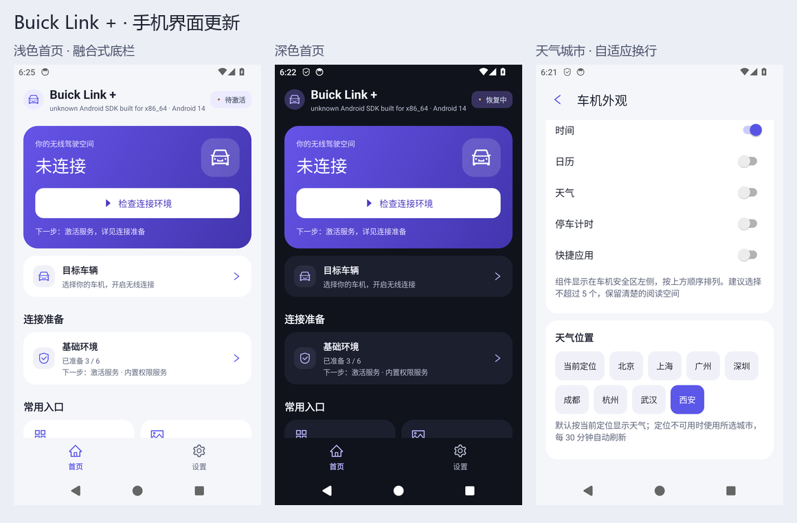

# Buick Link +

把手机 CarLife+ 的画面、声音和触摸通过无线 CarPlay 投到车机。本项目**基于 [schemawisp/link_plus](https://github.com/schemawisp/link_plus)（Buick Link+，MIT）开发**，在它的蓝牙 iAP2 / AirPlay / VideoSender / AudioSender 基础上增加 CarLife 内容源；手机无需 root，也不需要开发者选项、无线调试或 ADB；最低支持 Android 12。

适配范围：当前**仅适配别克车型**；手机端 CarLife 先保证荣耀机型（荣耀车联 / CarLife+ 无线连接），其它 Android 手机的 CarLife+ 兼容性按反馈逐步验证。连接原理见 [CarLife 连接机制](docs/carlife-mechanism.md)。



## 开始使用

无需开发者选项、无线调试或 ADB：安装后授予普通权限（蓝牙、附近 Wi-Fi、通知等，按需申请）并连接车机；画面来自手机 CarLife+，需先在手机上打开 CarLife+ 并进入「无线连接」。无需另装 Shizuku。权限与链路说明见 [无 ADB 模型与权限](docs/no-adb-model.md)。

车型和系统版本会影响连接效果。目前 Android 17 息屏后保持连接仍有问题，欢迎反馈具体机型和日志。驾驶时请勿操作手机。

## 实车测试包与反馈

- 测试包：buick 变体 APK（`app/build/outputs/apk/buick/app-buick.apk`），版本号与 SHA-256 随发布说明提供；
- 反馈日志：应用内「设置 → 日志与关于 → 导出日志」导出完整日志，附上手机/车机型号、系统版本、应用版本、复现步骤；
- 开发调试：`scripts/p1a-field-check.ps1` 可抓取并校验 CarLife 链路日志（`scripts/verify-carlife-log.ps1` 单独校验已有日志）。

## 构建

使用 JDK 17、Android SDK 34、Build Tools 35.0.0 和 NDK 27.0.12077973。工程自带 Gradle 8.13，使用 AGP 8.13.2 和 Kotlin 2.3.21。通过 `ANDROID_HOME` 或 `local.properties` 配置本机 SDK 路径。

```powershell
./gradlew.bat spotlessCheck :app:testBuickUnitTest :app:lintDebug :app:lintBuick
./gradlew.bat :app:assembleBuick
```

APK 位于 `app/build/outputs/apk/buick/app-buick.apk`，测试包使用 `.buick` 后缀。正式签名通过 `keystore.properties` 配置，可参考同名示例文件；缺少配置时使用本机测试签名。不同签名的安装包不能直接覆盖安装。

## 文档

- [功能与界面说明](docs/PORT_MATRIX.md)
- [开发目标、实现与测试](docs/CARLIFE_PORT_PLAN.md)
- [CarLife 连接机制](docs/carlife-mechanism.md)
- [无 ADB 模型与权限](docs/no-adb-model.md)
- [GitHub 下游同步流程](docs/GITHUB_WORKFLOW.md)
- [项目结构](docs/architecture.md)
- [第三方组件与许可](docs/dependencies.md)
- [English](README.en.md)

## 许可与声明

本项目基于 [schemawisp/link_plus](https://github.com/schemawisp/link_plus)（Buick Link+，MIT；其上游为 [shaonialife/cardeck](https://github.com/shaonialife/cardeck)），保留原始 [MIT 许可与版权声明](LICENSE)。第三方组件遵循各自许可，详见上面链接的许可说明。

**代码来源与归属**

- 上游基础：[schemawisp/link_plus](https://github.com/schemawisp/link_plus)（MIT）——本仓库是它的下游 fork，保留上游 LICENSE。
- CarLife 协议/客户端/视频/音频部分使用了 [CarPToCarL](https://github.com/jjuugk/CarPToCarL) 的 MIT 开源实现（commit `7b729fb`，Copyright (c) 2026 lizhihua），并按 link_plus 的链路改造（解码到 `VideoSender` 编码器 Surface、音频经 `AudioSender`、无 ADB 化等）；逐文件说明见 [docs/third-party/CarPToCarL-NOTICE.md](docs/third-party/CarPToCarL-NOTICE.md)，源码文件头也保留了来源注释。
- **本项目不提供、不分发旧闭源应用资源**（APK、图片、日志等）；不内置第三方壁纸图片，壁纸为程序生成背景或用户自定义图片。
- 上游与参考实现的 MIT 版权与许可声明均保留；再分发时请一并保留。

这是非官方项目，与别克、通用汽车、Apple、百度无关联，也未获其授权或认证。相关商标归各自所有者，应用名称只用于说明适配用途。
